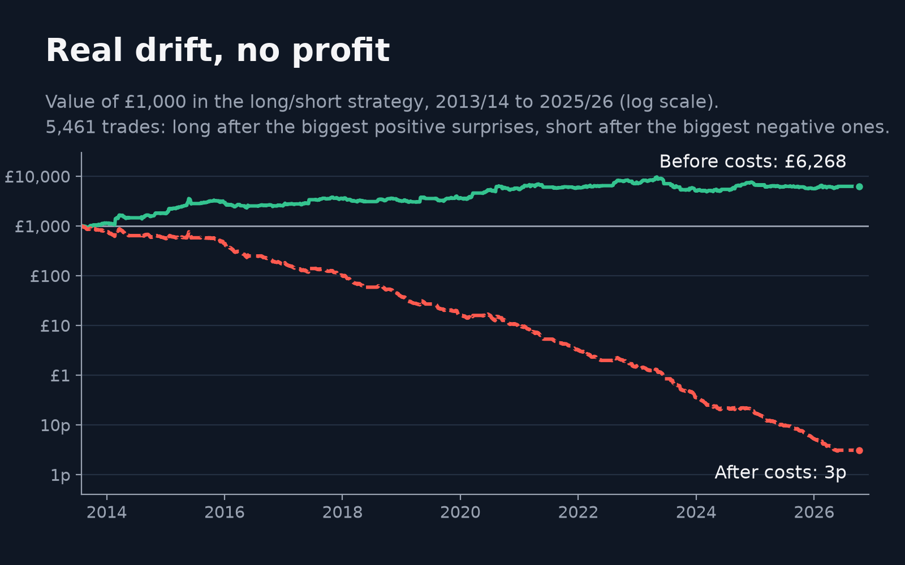

# Real Drift, No Profit: Football Club Shares and Betting Market Surprise

Listed football clubs' shares move on match results, but only on the part of the result the betting market did not expect. This project measures every result against the closing betting odds and finds that club shares underreact to that surprise: most of the price move happens on the first trading day, and a smaller part keeps drifting in the same direction over the next three days. The drift is real and statistically significant, but it is far smaller than the cost of trading these thinly traded shares, so a strategy built on it loses almost everything after costs.

Read the full write up on Substack: [jordanbuch.substack.com](https://jordanbuch.substack.com/p/can-you-profit-when-the-betting-odds)



## Key results

| | |
|---|---|
| Sample | 14 listed clubs in 8 leagues, seasons 2012/13 to 2025/26, 10,038 club matches (league, European and cup); 9,834 of them have a share price on day 0, the first trading day that closes after the match ends |
| Surprise | Actual result (win +1, draw 0, loss −1) minus the result the odds expected; it runs from −2 to +2 |
| Day 0 reaction | +1.05% abnormal return per unit of surprise on the first trading day after the match |
| Drift | A further +0.23% per unit of surprise over trading days 1 to 3 (p = 0.004): shares underreact |
| Backtest | 5,461 long/short trades from 2013/14: long after the biggest positive surprises, short after the biggest negative ones, held for up to 3 days and hedged with the local index |
| Before costs | £1,000 grows to £6,268 |
| After costs | £1,000 falls to 3p |
| Why | The gross edge is about 0.18% per trade; a round trip costs about 1.1% (estimated bid/ask spread, commission and taxes) |

Abnormal returns are share returns minus beta times the local stock index. The drift test is a panel regression of each club's daily abnormal return on the surprises of all its matches, because a club plays every 3 or 4 trading days and fixed event windows overlap. The full method, robustness checks, a placebo test and the exploratory splits are in `docs/step4_event_study.md`.

## Data sources

The licensed data is **not included** in this repository. `data/README.md` explains how to obtain every source and where to put it.

| Source | Used for | Included? | How to get it |
|---|---|---|---|
| [football-data.co.uk](https://www.football-data.co.uk/) | League results and closing odds | No | Downloaded by the code |
| [Betfair Exchange historical data](https://historicdata.betfair.com/) (BASIC) | European and cup odds, results and kickoff times from May 2015 | No, licensed | Your own Betfair account and app key, then downloaded by the code |
| [OddsPortal](https://www.oddsportal.com/) | European and cup odds 2012/13 to 2014/15, gaps in Betfair, competition names | No, terms forbid redistribution | Scraped by hand with OddsHarvester (commands in `docs/step1b_betfair.md`) |
| [openfootball](https://github.com/openfootball/champions-league) | European fixture lists | No | Downloaded by the code |
| Wikipedia (club and league season articles) | Competition names, friendlies, coverage check, league tables | No | Downloaded by the code |
| Yahoo Finance (`yfinance`) | Daily share prices and stock indices | No | Downloaded by the code |
| Bloomberg terminal | AS Roma prices after its 2022 delisting, PSI 20 index, corporate actions | No, licensed | Exported by hand from a terminal (layout in `data/README.md`) |

## Repository structure

```
README.md
LICENSE                     MIT
requirements.txt            pinned package versions (tested on Python 3.11 and 3.13)
.env.example                Betfair credential names (copy to .env, never commit .env)
config/clubs.yaml           clubs, tickers, leagues, team name spellings, manual corrections
data/README.md              how to get each data source (data itself is not committed)
notebooks/pipeline.ipynb    the full pipeline: acquisition, cleaning, strategy, backtest
src/                        one module per step
  step1_expectations.py       league odds to probabilities
  step1b_betfair.py           European and cup odds (Betfair, with OddsPortal for gaps)
  oddsportal.py               OddsPortal files
  european_fixtures.py        openfootball fixtures
  wikipedia_fixtures.py       Wikipedia club season articles
  step2_surprise.py           match surprise
  step3_prices.py             share prices, trading calendars, event day
  league_tables.py            league tables before every match (stakes split)
  step4_event_study.py        abnormal returns, event study, placebo, backtest
  substack_charts.py          the dark theme charts in figures/
  cost_audit.py               checks of the backtest's trading costs (optional)
  per_club.py                 club by club breakdown (optional, exploratory)
figures/                    charts (substack_*.png are the dark theme versions)
docs/                       method notes for every step, data issues log, literature
tests/                      offline tests on synthetic data
```

## How to run

1. Clone the repository and install the pinned packages (Python 3.11 or later):

   ```
   git clone https://github.com/jordanbuch13/real-drift-no-profit.git
   cd real-drift-no-profit
   python -m venv .venv && source .venv/bin/activate
   pip install -r requirements.txt
   python -m pytest tests
   ```

2. Get the data (see `data/README.md`). Manual steps:
   * **Betfair:** create an account and app key, add the free BASIC football plan at historicdata.betfair.com, and put your credentials in `.env`.
   * **OddsPortal:** scrape the listed pages with OddsHarvester into `data/raw/oddsportal/`.
   * **Bloomberg:** export the AS Roma and PSI 20 workbook into `data/raw/bloomberg/`.

   Everything else downloads automatically when you set `DOWNLOAD = True` in the notebook.

3. Open `notebooks/pipeline.ipynb` in Jupyter or VS Code and run all cells. With the raw data in place it rebuilds `data/processed/` and the charts in `figures/` in about 2.5 minutes.

4. Optional extras, from the repository root:

   ```
   python -m src.cost_audit      # cost breakdown, turnover, cost sensitivity
   python -m src.per_club        # club by club results (exploratory)
   ```

A fresh download of Yahoo Finance and Wikipedia can differ slightly from the snapshot used for the published results (taken 5 to 9 October 2026).

## Licence

Code is released under the MIT licence (see `LICENSE`). The licence does not cover any third party data.
